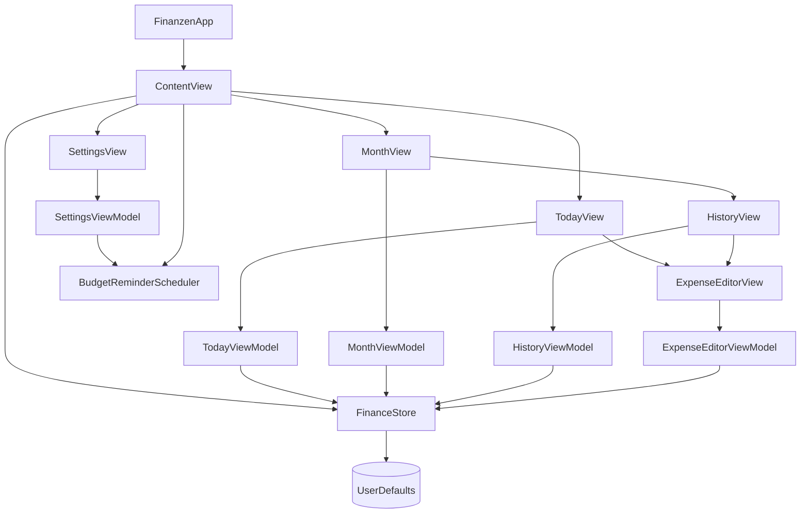

# Finanzen

**Finanzen** ist eine deutschsprachige iOS-App für die persönliche Budgetplanung. Sie hilft dabei, ein Monatsbudget im Blick zu behalten und tägliche Ausgaben manuell zu erfassen. Aus dem noch verfügbaren Monatsbudget berechnet die App ein Tageslimit, das sich an die tatsächlichen Ausgaben anpasst: Nicht verbrauchtes Tagesbudget wird auf die verbleibenden Tage verteilt.

Die App ist mit **SwiftUI** umgesetzt und für iPhone und iPad ausgelegt. Budgets und Ausgaben bleiben auf dem Gerät; ein Konto, eine Bankverbindung oder eine Cloud-Synchronisierung sind nicht erforderlich.

## Funktionen

- Drei Bereiche: **Heute** für das Tagesbudget und die heutigen Ausgaben, **Monat** für Budget und Monatsfortschritt sowie **Einstellungen** für Darstellung und Erinnerungen.
- Tageslimit, heutige Ausgaben, verbleibender Betrag und das berechnete Limit für morgen.
- Negative Tagesbeträge werden angezeigt, wenn die Ausgaben das Tageslimit überschreiten.
- Monatsbudget mit frei wählbarem Startdatum für die tägliche Aufteilung.
- Monatsfortschritt mit Ausgaben, Restbetrag und Fortschrittsanzeige.
- Ausgaben manuell erfassen, kategorisieren, mit einer Notiz versehen, bearbeiten und löschen.
- Monatsweise Ausgabenhistorie mit Tagessummen, erreichbar über den Verlauf im Monat-Bereich.
- Helles, dunkles oder systemgesteuertes Erscheinungsbild.
- Optionale Erinnerung am Monatsersten um 9 Uhr, ein Monatsbudget festzulegen.
- Helles, dunkles und getöntes App-Icon in den Asset-Varianten.

## Tagesbudget-Berechnung

Das Monatsbudget wird ab dem gewählten Startdatum auf die verbleibenden Kalendertage verteilt. Für den heutigen Tag wird zunächst das **Tageslimit** aus dem noch vorhandenen Monatsbudget und den verbleibenden Tagen berechnet. Der **verbleibende Betrag** ergibt sich aus:

```text
heutiges Tageslimit − heutige Ausgaben
```

Wird das Limit überschritten, ist der verbleibende Betrag negativ. Nicht ausgegebene Beträge bleiben im Monatsbudget und erhöhen damit automatisch die späteren Tageslimits. Das Limit für morgen berücksichtigt die bis dahin erfassten Ausgaben.

Jedes Monatsbudget und sein Aufteilungsstart werden getrennt für den jeweiligen Monat gespeichert. Ist für den ausgewählten Monat noch kein Budget festgelegt, zeigt der Monat-Tab zuerst die Budgeteingabe statt der Monatsübersicht.

## Projektstruktur

```text
.
├── Finanzen.xcodeproj/              Xcode-Projekt und App-Target
├── Finanzen/
│   ├── FinanzenApp.swift            App-Einstiegspunkt
│   ├── Models/
│   │   ├── Expense.swift            Ausgabenmodell
│   │   ├── AppTheme.swift           Theme-Auswahl und Akzentfarbe
│   │   └── FinanceStore.swift       Lokale Speicherung, Budgetregeln und Undo
│   ├── ViewModels/
│   │   ├── TodayViewModel.swift
│   │   ├── MonthViewModel.swift
│   │   ├── SettingsViewModel.swift
│   │   ├── HistoryViewModel.swift
│   │   └── ExpenseEditorViewModel.swift
│   ├── Views/
│   │   ├── ContentView.swift
│   │   ├── TodayView.swift
│   │   ├── TodayExpenseEntry.swift
│   │   ├── MonthView.swift
│   │   ├── SettingsView.swift
│   │   ├── HistoryView.swift
│   │   ├── ExpenseRow.swift
│   │   └── ExpenseEditorView.swift
│   ├── Services/
│   │   └── BudgetReminderScheduler.swift
│   └── Assets.xcassets/
│       └── AppIcon.appiconset/      Standard-, Dark- und Tinted-App-Icons
├── README.md
└── todos.md                         Projekt-Checkliste und weitere Aufgaben
```

## Architektur (MVVM)

Die App ist nach **Model–View–ViewModel (MVVM)** aufgebaut. `FinanzenApp` startet `ContentView`; diese verwaltet die Tab-Navigation und erzeugt den gemeinsamen `FinanceStore`, der an die Finanzansichten weitergegeben wird.



Die Zuständigkeiten der Schichten:

- **Models und Store:** `Expense` beschreibt eine Ausgabe. `FinanceStore` ist die gemeinsame Quelle für Budgets, Startdaten und Ausgaben. Er kapselt Speicherung, Budgetberechnung und Lösch-Undo.
- **ViewModels:** `TodayViewModel`, `MonthViewModel`, `SettingsViewModel`, `HistoryViewModel` und `ExpenseEditorViewModel` liegen jeweils in einer eigenen Datei unter `ViewModels/`. Sie bereiten die benötigten Daten und Aktionen für ihre Ansichten auf und koordinieren Änderungen am Store.
- **Views:** Die SwiftUI-Ansichten liegen unter `Views/`. Sie zeigen den Zustand an und leiten Nutzeraktionen an ihr ViewModel weiter. Der Ausgabenverlauf und die Ausgabeerfassung werden als Ansichten aus dem Heute- beziehungsweise Monat-Bereich geöffnet.
- **Services:** `BudgetReminderScheduler` liegt unter `Services/` und kapselt die Planung lokaler iOS-Mitteilungen. Er wird von den Einstellungen konfiguriert und beim Start der App bei Bedarf aktualisiert.

Der typische Datenfluss verläuft von der View über das ViewModel zum `FinanceStore`. Der Store veröffentlicht Änderungen über `ObservableObject`; dadurch aktualisieren sich die betroffenen Ansichten. Der Store speichert Ausgaben, Monatsbudgets und Budgetstartdaten lokal in `UserDefaults`.

## Daten und Benachrichtigungen

Ausgaben, Monatsbudgets und Startdaten werden als Codable-JSON in `UserDefaults` auf dem Gerät gespeichert. Es gibt weder ein Benutzerkonto noch einen App-Server oder eine Cloud-Synchronisierung.

Die Monatserinnerung ist standardmäßig ausgeschaltet. Sie lässt sich unter **Einstellungen → Erinnerungen** einschalten. iOS fragt dann nach der Berechtigung für Mitteilungen. Bei erteilter Berechtigung plant die App die nächste Erinnerung für den ersten Tag eines Monats um 9 Uhr.

## Voraussetzungen und Starten

- Xcode mit iOS-Simulator-Unterstützung
- iOS-Deployment-Target: iOS 17.0
- Keine externen Swift-Package-Abhängigkeiten

1. `Finanzen.xcodeproj` in Xcode öffnen.
2. Das Scheme **Finanzen** und einen iOS-Simulator auswählen.
3. Mit **Run** starten.

Alternativ lässt sich der Simulator-Build über die Kommandozeile erstellen:

```sh
xcodebuild \
  -project Finanzen.xcodeproj \
  -scheme Finanzen \
  -destination 'platform=iOS Simulator,name=iPhone 18 Pro' \
  build \
  CODE_SIGNING_ALLOWED=NO
```

Die Projekt-Checkliste und geplante Verbesserungen stehen in [`todos.md`](todos.md).
